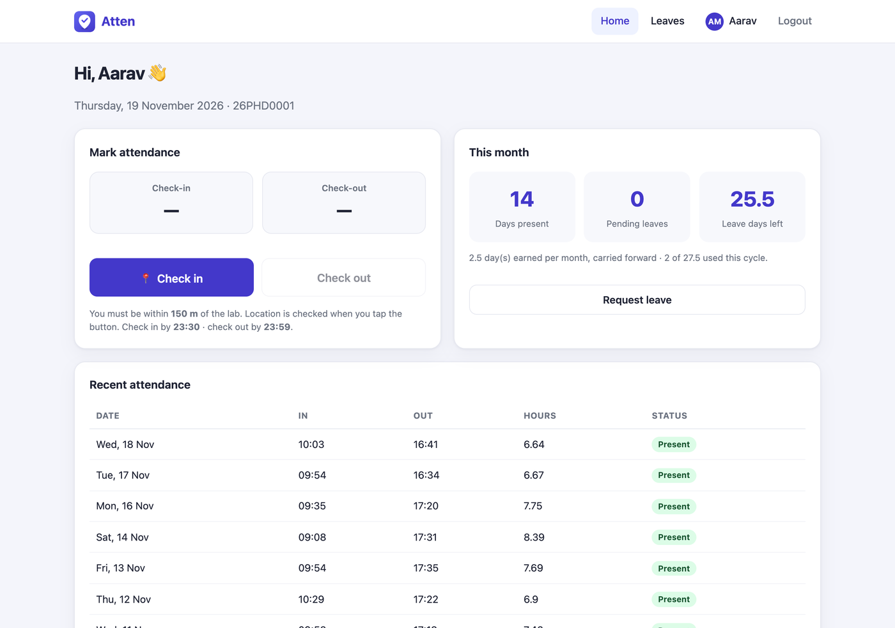
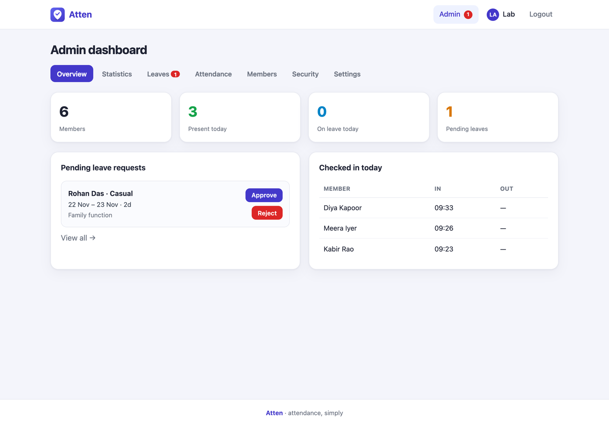
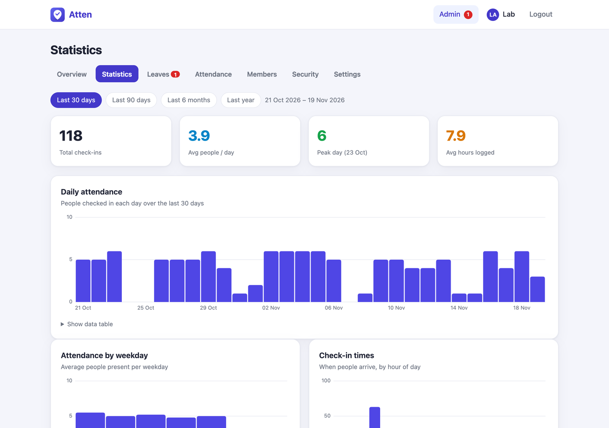

<p align="center">
  
</p>

<h1 align="center">Atten</h1>

<p align="center">
  Location-aware attendance for labs, studios and small teams.<br>
  Members check in only when they are actually there. Admins handle leave and the roster from one place.
</p>

<p align="center">
  
</p>

---

## What it does

- **Check in from your phone or laptop.** It only works when you are within a set distance of the lab.
- **Attendance window.** Check-in closes at a set time each day (17:00 by default), so nobody can fill in a day later from home.
- **Lab network check (optional).** Requests can be required to come from the lab's Wi-Fi or network.
- **Device binding.** Each person can use at most 3 devices. If someone checks in for another person, the system catches it, cancels that day and alerts the admin.
- **Leave management.** Members get leave days every month and unused days carry forward. They can request full or half days, and admins approve or reject them.
- **Statistics.** Charts for the whole lab and for each member: attendance rate, arrival times and hours logged.
- **Notifications.** Optional Discord messages for check-ins, plus emails about leave requests.
- **Simple to run.** Python and SQLite, with no build step or frontend framework. It works on phones and desktops.

<p align="center">
  
  
</p>

---

## Quick start

You need **Python 3.10 or newer**.

```bash
git clone https://github.com/<your-username>/atten.git
cd atten
python -m venv .venv && source .venv/bin/activate   # Windows: .venv\Scripts\activate
pip install -r requirements.txt
python app.py
```

Open **http://127.0.0.1:5001** and log in as the built-in admin:

| Lab ID     | Password    |
|------------|-------------|
| `labadmin` | `admin@123` |

> **Change this password right away** (Profile → Change password).

The database (`instance/atten.db`) is created automatically on first run.

---

## Setting up your lab (admin, about 5 minutes)

1. **Name your lab:** go to **Admin → Settings** and enter the lab name.
2. **Set the location:** stand inside the lab, tap **Use my current location**, choose a radius (100–150 m works well) and save.
3. **Check the rules:** on the same page, confirm the leave days earned per month, the date leave starts accruing, and the check-in/check-out cutoff times.
4. **Add your people.** Do either of these:
   - edit `static/people.csv` before the first run (see [Roster file](#roster-file)), or
   - add them one by one under **Admin → Members**.
5. **Optional:** in **Admin → Settings**, connect a Discord webhook or an email (SMTP) account for notifications, and turn on the lab network check.

---

## For members

1. **First login:** open the site, enter the **Lab ID** your admin gave you, and create your own password.
2. **Check in:** when you arrive, open **Home** and tap **Check in**. Allow location access if your browser asks.
3. **Check out:** tap **Check out** before you leave.
4. **Take leave:** open **Leaves** and pick the dates and type. Tick *half day* if you only need part of a day. Your balance is shown as you choose dates.
5. **Profile:** add your photo, email and phone, or change your password.

**If check-in doesn't work:**

| Message | What to do |
|---|---|
| *You are X m from the lab…* | Move closer, or turn on precise location / GPS. |
| *Location permission denied* | Allow location for this site in your browser settings and reload. |
| *Location unavailable* | Turn on GPS / location services and try again. |
| *Check-in closed at 17:00* | The day's window has passed. Ask your admin. |
| *You must be on the lab network (Wi-Fi)…* | Connect to the lab Wi-Fi. |
| *Attendance is limited to N devices…* | Ask your admin to remove an old device from your account. |

> Don't check in for someone else from your phone. The system detects it, cancels the attendance for that day and flags both accounts.

---

## Roster file

`static/people.csv` is loaded on first run. People already in the database are skipped, so it is safe to run again.

```csv
lab_id,name,designation,funding,joined
26PHD0001,Aarav Mehta,PhD,Institute,2026-01
```

| Column | Required | Notes |
|---|---|---|
| `lab_id` | yes | Unique login ID |
| `name` | yes | Full name |
| `designation` | no | e.g. PhD, MSR, Research Associate |
| `funding` | no | Free text |
| `joined` | no | `YYYY-MM`. Leave starts building up from this month |
| `gender` | no | `female` turns on the monthly menstrual-leave grant |

The file that ships here contains fictional sample people. Replace them with your own.

---

## Deploying to a server

Browsers **only share location over HTTPS**, so a real deployment needs a domain with TLS in front of the app.

1. Copy the environment file and set a secret key:
   ```bash
   cp .env.example .env && chmod 600 .env
   python -c "import secrets; print(secrets.token_hex(32))"   # paste this into SECRET_KEY
   ```
2. Run the app with gunicorn using **one worker** (SQLite has only one writer):
   ```bash
   set -a; source .env; set +a
   gunicorn --workers 1 --threads 8 --bind 127.0.0.1:5001 app:app
   ```
3. Put a reverse proxy in front and set `TRUST_PROXY=1`. Example configs:
   - [`deploy/nginx.conf`](deploy/nginx.conf): nginx, serving the app under `/attendance/`
   - [`deploy/atten.service`](deploy/atten.service): systemd unit. **Set `TZ` to your lab's timezone**, because the cutoff times use local time.

| Variable | Purpose |
|---|---|
| `SECRET_KEY` | Signs login sessions. **Required in production.** |
| `PORT` | Port for `python app.py` (default 5001) |
| `TRUST_PROXY` | Set to `1` only when a reverse proxy is in front |
| `DATABASE_URL` | Optional. Overrides the SQLite file location |
| `DISCORD_WEBHOOK_URL`, `SMTP_*` | Optional fallbacks. These are normally set in Admin → Settings |

---

## How the anti-cheating layers work

Each check-in passes through these checks in order:

1. **Time window.** The server rejects check-ins after the cutoff.
2. **Lab network.** Checks the source IP against your allowlist. Each check can be set to `off`, `warn` (allow it but flag it) or `enforce` (block it).
3. **Geofence.** The browser's GPS position is compared with the lab location.
4. **Device binding.** A long-lived cookie plus a browser fingerprint. A device that is already registered to another account cannot check in.

**Limits:** a web page cannot prove where someone is, because GPS can be faked on a phone. The network check is the strongest layer, so start it on `warn` for a few days and watch **Admin → Security** before you switch to `enforce`. Browsers cannot read MAC addresses, so device binding is per browser, not per piece of hardware.

---

## Project layout

```
app.py              routes and all business logic (geofence, leave quota, device binding, stats)
models.py           database models: User, Attendance, LeaveRequest, Device, SecurityFlag, Setting
config.py           default values (most can be changed live from Admin → Settings)
notify.py           Discord webhook messages
mailer.py           leave emails over SMTP
templates/          Jinja HTML pages
static/             CSS, JS (attendance client and SVG charts), logo, sample roster
deploy/             example nginx and systemd configs
```

New database columns are added automatically on startup, so upgrades need no manual migration.

**Tech:** Flask · Flask-SQLAlchemy (SQLite) · Flask-Login · vanilla JS and CSS.

---

## License

[MIT](LICENSE) — free to use, modify and share, including commercially.
